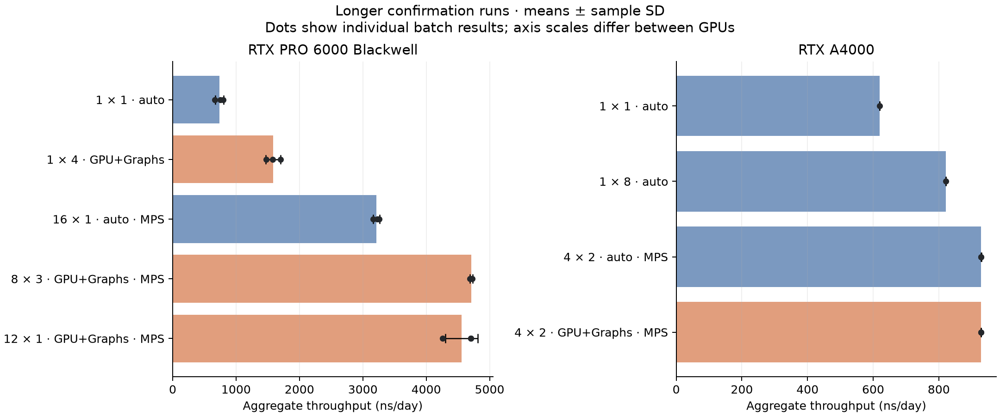

# GROMACS 2026.1 GPU Concurrency Benchmark: RTX PRO 6000 Blackwell vs RTX A4000

**Measured RNase cubic performance · 24,040 atoms · GROMACS 2026.1 · CUDA MPS · CPU-thread allocation**

This benchmark measures total throughput from independent molecular dynamics simulations sharing one NVIDIA GPU. It compares two complete workstations: RTX PRO 6000 Blackwell with Core Ultra 9 285K, and RTX A4000 with Xeon w5-2455X. It explores NVIDIA CUDA Multi-Process Service (MPS), a combined GPU-bonded/CUDA-Graphs path, concurrency and OpenMP workers per simulation.

**79 completed batches and 432 successful MD processes.** Selected settings received longer confirmation runs; all completed logs passed the execution audit before the requested MD-file cleanup.

## Measured results at a glance

`N × T` means N independent MD jobs, each with one thread-MPI rank and T OpenMP workers. All three rows below use MPS and GPU bonded + CUDA Graphs.

| GPU / choice | N × T | Nominal CPU workers | Aggregate ns/day, mean ± sample SD | Batches | Full-batch ns/day | Task GPU peak MiB | Task RAM PSS peak MiB |
|---|---:|---:|---:|---:|---:|---:|---:|
| RTX PRO 6000 Blackwell / highest confirmed mean | 8 × 3 | 24 | 4711.8 ± 20.9 | 3 | 4417.5 | 4692 | 967.7 |
| RTX PRO 6000 Blackwell / fewer CPU workers | 12 × 1 | 12 | 4556.0 ± 256.8 | 3 | 4301.3 | 7012 | 1340.6 |
| RTX A4000 / confirmed plateau | 4 × 2 | 8 | 929.3 ± 0.006 | 2 | 912.5 | 774 | 515.5 |

- Blackwell 8 × 3 delivered **2.97×** the fastest confirmed single-MD setting on that workstation. This gain combines concurrency, MPS and the chosen execution path; it is not an isolated MPS-only speedup.
- Blackwell 12 × 1 retained **96.7%** of that mean throughput with half the nominal OpenMP workers, with greater observed batch variability.
- On A4000, auto bonded and GPU bonded + Graphs were effectively tied near 929 ns/day at 4 × 2. The 4 × 1 auto-bonded screen was already near the plateau, but did not receive longer confirmation before the requested early stop.

The aggregate metric sums each process’s post-warm-up rate. Full-batch throughput includes startup, warm-up and completion-tail effects. Cross-workstation differences include CPU and build differences; they are not a GPU-only hardware comparison. These short performance runs do not establish scientific equilibration.

## Questions this dataset helps answer

### How many concurrent GROMACS jobs should I run on RTX PRO 6000 Blackwell?
For this 24,040-atom RNase input, 8 jobs with 3 OpenMP workers each had the highest longer-run mean among tested settings. Twelve jobs with one worker each were a useful CPU-saving alternative. Other molecular systems may prefer different settings.

### Does CUDA MPS help small GROMACS simulations?
It can improve GPU sharing when one process leaves capacity unused. The matched Blackwell 8 × 3 screening control measured approximately 2.18× aggregate throughput with MPS versus without it. That control has one run per setting; the larger 2.97× ensemble-versus-single comparison changes more than MPS alone.

### Should I always enable GPU bonded and CUDA Graphs?
The combined path helped this Blackwell workload. It did not establish a throughput advantage over auto bonded on A4000. This extension changed GPU-bonded offload and CUDA Graphs together and does not isolate their individual effects.

### Do GPU-wait timers prove a PCIe transfer bottleneck?
No. They can include preceding GPU execution and synchronization. The report supports a CPU/offload/sharing interpretation, while distinguishing GPU arithmetic, device-memory bandwidth and PCIe traffic would require separate hardware profiling.

## Full methodology, data and reproduction

- [Full English benchmark report](REPORT.md)
- [Configuration summary CSV](configuration_summary.csv) and [JSON](configuration_summary.json)
- [Input provenance and reproduction commands](REPRODUCE.md)
- [Extracted per-task Blackwell data](data/local-study.json) and [A4000 data](data/remote-study.json)
- [Blackwell task-memory samples](data/local-task-memory.csv) and [A4000 task-memory samples](data/remote-task-memory.csv)
- [Blackwell audit record](data/local-audit.json) and [A4000 audit record](data/remote-audit.json)
- [Privacy and checksum notes](PUBLICATION_NOTES.md)
- [Reuse and licensing guidance](LICENSE_GUIDANCE.md)

Upstream input: [Páll, supplementary GROMACS benchmark dataset, DOI 10.5281/zenodo.3893789](https://zenodo.org/records/3893789). The exact input hash and build details are in the report. Original MD input copies, energies, trajectories, checkpoints and runtime logs were deleted after result extraction and successful audit, at the owner’s request. Extracted rates, command lines, timings and audit records remain available.

Hardware and software versions are intentionally public. Absolute test timestamps and time zones are withheld; elapsed times and sampled intervals are retained. Publication-platform commit/release dates are separate from the withheld test times.
