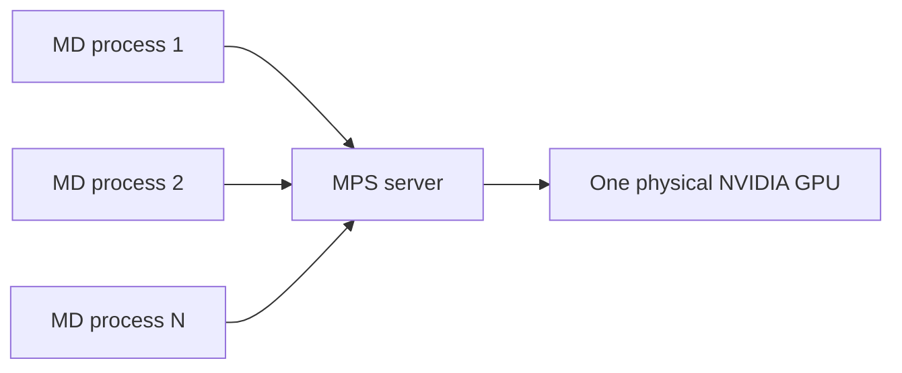
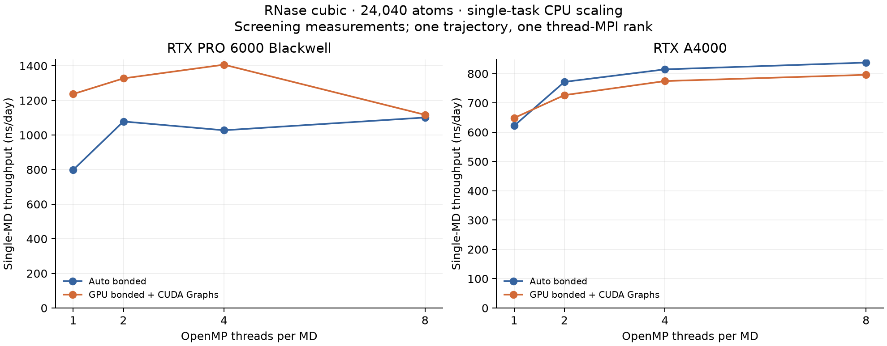
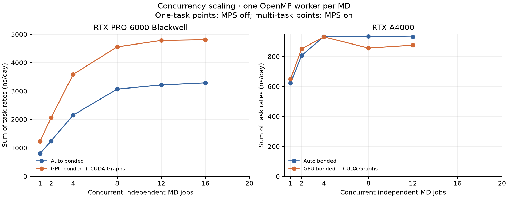
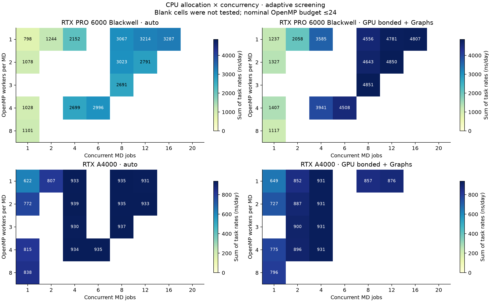
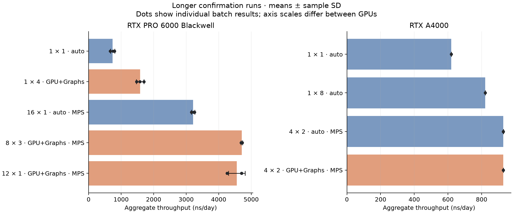

# GROMACS 2026.1 GPU Concurrency Benchmark: RTX PRO 6000 Blackwell vs RTX A4000

Absolute test dates and time zones are withheld; durations and relative sampling times are retained.

## Executive findings

This report compares independent RNase simulations on the two existing workstations. `N × T` means N concurrent MD processes, each using one thread-MPI rank and T OpenMP workers. Both studies started from the same scheduled time and then followed separate adaptive schedules.

- **RTX PRO 6000 Blackwell:** best confirmed ensemble = **8 × 3, MPS on, GPU bonded + CUDA Graphs**, **4711.8 ± 20.9 ns/day** (mean ± sample SD, n=3). This is **2.97×** the fastest confirmed single-MD configuration, or **6.38×** the one-worker auto-bonded baseline. Full-batch throughput was **4417.5 ns/day**.
  CPU-saving candidate: **12 × 1, GPU bonded + CUDA Graphs**, 4556.0 ± 256.8 ns/day using **12 nominal OpenMP workers**, retaining **96.7%** of the confirmed peak. This candidate was selected within 95% of the screening peak and then independently confirmed.
- **RTX A4000:** best confirmed ensemble = **4 × 2, MPS on, GPU bonded + CUDA Graphs**, **929.3 ± 0.006 ns/day** (mean ± sample SD, n=2). This is **1.13×** the fastest confirmed single-MD configuration, or **1.50×** the one-worker auto-bonded baseline. Full-batch throughput was **912.5 ns/day**.

The A4000 paths are effectively tied at approximately 929 ns/day with 4 × 2; the tiny difference does not establish that GPU bonded + Graphs is faster. Auto bonded is also a sensible choice. Its 4 × 1 screen reached approximately 933 ns/day with only four nominal workers, but that CPU-saving option did not receive longer confirmation before the requested early stop.

These are the best confirmed configurations within the tested search, not an exhaustive global optimum. The full-batch metric includes launch, warm-up and completion-tail effects; the sum of task rates excludes the specified warm-up in each process.

## What MPS does

NVIDIA CUDA Multi-Process Service (MPS) is a lightweight service that coordinates GPU access from multiple CUDA processes. A control daemon manages a server, and clients share the server’s GPU scheduling resources. Kernels from different processes can overlap and GPU context-switching overhead can fall. Each MD trajectory remains an independent process with its own files and CUDA address space. Benefits are strongest when one process alone leaves usable GPU capacity. [NVIDIA MPS overview](https://docs.nvidia.com/deploy/mps/latest/index.html), [When to use MPS](https://docs.nvidia.com/deploy/mps/latest/when-to-use-mps.html).



| Mechanism | Role in this study |
|---|---|
| thread-MPI | One rank per independent MD |
| OpenMP | CPU workers inside each MD |
| CUDA MPS | GPU sharing across independent MD processes |
| CUDA Graphs | Replays a process’s GPU execution graph to reduce repeated launch overhead |

## Hardware and controlled setup

| Workstation | CPU topology | GPU |
|---|---|
| `Blackwell-workstation` | Core Ultra 9 285K: 24 cores / 24 logical CPUs; 8 P-cores + 16 E-cores | RTX PRO 6000 Blackwell, approximately 96 GiB |
| `A4000-workstation` | Xeon w5-2455X: 12 physical cores / 24 logical CPUs | RTX A4000, approximately 16 GiB |

| Platform detail | Blackwell workstation | A4000 workstation |
|---|---|---|
| Operating system | Ubuntu 26.04.1 LTS | Ubuntu 24.04.4 LTS |
| Linux kernel | 7.0.0-43-generic | 7.0.0-43-generic |
| NVIDIA driver | 595.99.02 | 595.99.02 |
| GCC host compiler | 13.4.0 | 13.3.0 |

The local CPU is heterogeneous; the remote CPU exposes SMT siblings. The same nominal worker budget therefore does not imply the same number or type of physical cores. Core placement was left to the OS (`-pin off`). [Intel 285K specifications](https://www.intel.com/content/www/us/en/products/sku/241060/intel-core-ultra-9-processor-285k-36m-cache-up-to-5-70-ghz/specifications.html), [Intel w5-2455X specifications](https://www.intel.com/content/www/us/en/products/sku/233420/intel-xeon-w52455x-processor-30m-cache-3-20-ghz/specifications.html).

- Input: RNase cubic, RNASE ZF-1A in water, **24,040 atoms**, from the [published benchmark dataset](https://zenodo.org/records/3893789).
- Identical input SHA-256: `bd10c90ca230d76ef5fc1555dc24789f1162d18e36037007d9f325d9c760a54a`.
- GROMACS **2026.1**, CUDA toolkit **13.1.115**, FFTW **3.3.10**, mixed precision, cuFFT, thread-MPI and OpenMP.
- Hardware-specific builds: AVX2 / sm_120 locally; AVX-512 / sm_86 remotely. Absolute cross-host differences are not a GPU-only hardware comparison.
- The local CUDA 13.1 toolchain needed four declaration-only `noexcept` additions for compatibility with glibc 2.42. Arithmetic implementations were unchanged; see `cuda-glibc-compatibility.patch`. The remote build used the unmodified CUDA 13.1 headers.
- One rank per MD; fixed 2 fs timestep; PME on GPU; PME tuning disabled; coordinate/constraint update on GPU when supported; final coordinate output suppressed.
- Standard path: `-bonded auto`. Graph path: `-bonded gpu` and `GMX_CUDA_GRAPH=1`; actual graph execution was verified from MD Graph counters. This is a bundled path comparison, so its gain cannot be attributed to CUDA Graphs alone.
- Nominal OpenMP budget N×T ≤24; search safety limit 20 processes. MPS/driver helper threads are additional to this nominal worker count.
- Private MPS pipes, default MPS scheduling, no active-thread percentage partition. Only the experiment-owned controller is stopped.
- Screening: 80,000 steps, first 20,000 excluded. Confirmation: 200,000 steps, first 40,000 excluded. The initial plan was three repetitions per selected configuration; actual completed repetition counts are reported in the tables.
- Concurrency expanded through 2, 4, 8 and 12; 16 was added when 12 improved over lower counts by more than 3%; 20 was added if 16 improved by more than 5%. CPU-worker combinations were then explored around each path’s throughput peak.
- Input copies are benchmark replicas and do not establish independent scientific samples. Earlier experiments are not pooled into these statistics.

The CPU/GPU work balance and launch overhead depend on the system and offload settings; moving all work to the GPU is not universally best. [GROMACS performance guide](https://manual.gromacs.org/documentation/2026.1/user-guide/mdrun-performance.html).

## Metrics

`Aggregate rate = sum(P_i)`, where P_i is each process’s post-warm-up GROMACS Performance value in ns/day.

`Full-batch rate = N × simulated_ns_per_MD × 86400 / batch_wall_seconds`. This includes startup and warm-up. It is useful for fixed-length batches and can be lower when task speeds are imbalanced.

Confirmation variability is the sample standard deviation across batches, not a confidence interval. Screening points are single runs and are used for candidate selection. Three repeats do not establish a statistically significant ordering between close configurations. No background-load telemetry was saved.

Each process resets its own counters and reports over its own completion interval. These intervals are not a single globally synchronized steady-state window; faster jobs finishing can reduce contention for the remaining jobs. The full-batch metric complements the summed rates and should be considered when planning finite batches.

### Task-attributed memory

Memory is sampled approximately every five seconds for the study-owned GROMACS processes and the private MPS server only. GPU allocation is summed from their NVML process-memory records; RAM is the sum of their proportional set sizes (PSS), which apportions shared pages instead of counting them once per process. Desktop applications and unrelated system occupancy are excluded. GPU figures include the CUDA context and MPS overhead attributable to these jobs. The small MPS control daemon and Python benchmark harness are outside this memory scope.

Memory sampling was requested after screening had started. Missing earlier measurements remain unreported; available confirmation samples are included below. Reported peaks are sampled maxima, not a guarantee of the instantaneous absolute peak. Units are MiB (1024 MiB = 1 GiB).

## Single-trajectory CPU scaling



## Concurrency with one CPU worker per MD



## CPU allocation and concurrency together



Blank heatmap cells were not tested. Colors have a common scale across the two paths within each GPU; scales differ between GPUs.

## Longer confirmation runs



Dots show completed batches. A setting with only one dot has no estimated standard deviation. Repetition counts are given in the table.

| GPU | Path | N × T | MPS | Repeats | Aggregate ns/day, mean ± SD | Per-MD ns/day | Full-batch ns/day | Task GPU peak MiB | Task RAM PSS peak MiB |
|---|---|---:|---|---:|---:|---:|---:|---:|---:|
| RTX A4000 | auto bonded | 1 × 1 | off | 1 | 619.5 (single run) | 619.5 | 597.5 | 186 | 163.6 |
| RTX A4000 | auto bonded | 1 × 8 | off | 1 | 822.1 (single run) | 822.1 | 778.0 | 186 | 172.1 |
| RTX A4000 | auto bonded | 4 × 2 | on | 2 | 929.0 ± 0.4 | 232.3 | 912.5 | 766 | 514.9 |
| RTX A4000 | GPU bonded + CUDA Graphs | 4 × 2 | on | 2 | 929.3 ± 0.006 | 232.3 | 912.5 | 774 | 515.5 |
| RTX PRO 6000 Blackwell | auto bonded | 1 × 1 | off | 3 | 738.3 ± 65.4 | 738.3 | 713.5 | 578 | 173.4 |
| RTX PRO 6000 Blackwell | auto bonded | 16 × 1 | on | 3 | 3216.2 ± 50.6 | 201.0 | 3034.2 | 9268 | 1744.8 |
| RTX PRO 6000 Blackwell | GPU bonded + CUDA Graphs | 1 × 4 | off | 3 | 1584.5 ± 114.8 | 1584.5 | 1458.0 | 582 | 179.3 |
| RTX PRO 6000 Blackwell | GPU bonded + CUDA Graphs | 8 × 3 | on | 3 | 4711.8 ± 20.9 | 589.0 | 4417.5 | 4692 | 967.7 |
| RTX PRO 6000 Blackwell | GPU bonded + CUDA Graphs | 12 × 1 | on | 3 | 4556.0 ± 256.8 | 379.7 | 4301.3 | 7012 | 1340.6 |

## Matched MPS control

The control uses the same configuration and 80,000-step / 20,000-step screening protocol as its matching MPS-on screening run. These are single-run controls. A workstation without a completed control is omitted.

| GPU | Configuration | MPS on, ns/day | MPS off, ns/day | Ratio |
|---|---|---:|---:|---:|
| RTX PRO 6000 Blackwell | 8 × 3, GPU bonded + CUDA Graphs | 4851.3 | 2229.2 | 2.18× |

## Recommended commands

Use the tested executable rather than assuming the default `gmx` command has CUDA support.

| Workstation | Tested executable |
|---|---|
| `Blackwell-workstation` | `$GMX_BIN_BLACKWELL` |
| `A4000-workstation` | `$GMX_BIN_A4000` |

Start a private MPS controller once, then launch each trajectory in a separate directory. Retain the same MPS pipe environment for the controller and its clients. For each selected configuration, use the following core options:

**RTX PRO 6000 Blackwell: 8 × 3**

```bash
export GMX_CUDA_GRAPH=1
# Run 8 independent jobs, one output directory per job.
"$GMX" mdrun -s md.tpr -deffnm md -ntmpi 1 -ntomp 3 -pin off \
  -nb gpu -pme gpu -bonded gpu -update auto
```

**RTX A4000: 4 × 2**

```bash
export GMX_CUDA_GRAPH=1
# Run 4 independent jobs, one output directory per job.
"$GMX" mdrun -s md.tpr -deffnm md -ntmpi 1 -ntomp 2 -pin off \
  -nb gpu -pme gpu -bonded gpu -update auto
```

`$GMX` should be set to the executable in the table. The benchmark’s `-notunepme`, output suppression and counter resets were measurement controls; production choices should follow the actual system’s validated simulation settings. See `REPRODUCE.md` for an isolated MPS launch and full runner invocation.

## Bottleneck assessment

The useful distinction is between CPU preparation/launch work, sharing between GPU processes, and the remaining device execution path. The following evidence comes from configuration changes, rather than from a GPU-utilization percentage:

| GPU | Observation | Supported interpretation |
|---|---|---|
| RTX PRO 6000 Blackwell | Auto-bonded single MD: 798 ns/day at one worker; best screened CPU allocation 8 workers: 1101 ns/day. GPU-bonded + Graphs at one worker: 1237 ns/day. | CPU allocation and the offload/launch path can affect latency. The graph path changes two options together, so this extension does not isolate their individual contributions. |
| RTX PRO 6000 Blackwell | MPS, auto bonded, one worker per MD: 2 jobs: 1244; 4 jobs: 2152; 8 jobs: 3067; 12 jobs: 3214; 16 jobs: 3287 ns/day. | The curve identifies where adding independent jobs stops providing much throughput. A plateau is consistent with saturation of the shared execution path; it does not identify a specific GPU hardware unit. |
| RTX A4000 | Auto-bonded single MD: 622 ns/day at one worker; best screened CPU allocation 8 workers: 838 ns/day. GPU-bonded + Graphs at one worker: 649 ns/day. | CPU allocation and the offload/launch path can affect latency. The graph path changes two options together, so this extension does not isolate their individual contributions. |
| RTX A4000 | MPS, auto bonded, one worker per MD: 2 jobs: 807; 4 jobs: 933; 8 jobs: 935; 12 jobs: 931 ns/day. | The curve identifies where adding independent jobs stops providing much throughput. A plateau is consistent with saturation of the shared execution path; it does not identify a specific GPU hardware unit. |
| RTX PRO 6000 Blackwell | Matched 8 × 3 control: MPS on/off ratio 2.18×. | A large ratio supports GPU process-sharing/scheduling overhead as a material limit without MPS. A near-unity ratio indicates little benefit for this configuration. This control has one run per setting. |

### Internal GROMACS timing evidence

The following are arithmetic means of the reported per-process timing percentages across the indicated confirmation batches. They describe GROMACS host-side cycle accounting, not GPU hardware utilization or PCIe bandwidth. The overlapping PME breakdown is excluded.

| GPU | Configuration | Force % | Neighbor search % | Wait GPU state copy % | MD Graph % |
|---|---|---:|---:|---:|---:|
| RTX PRO 6000 Blackwell | 1 × 1, auto bonded | 55.5 | 18.5 | 5.4 | n/a |
| RTX PRO 6000 Blackwell | 1 × 4, GPU bonded + CUDA Graphs | 0.9 | 18.9 | 40.7 | 4.1 |
| RTX PRO 6000 Blackwell | 8 × 3, GPU bonded + CUDA Graphs | 0.4 | 15.2 | 61.6 | 2.8 |
| RTX A4000 | 1 × 1, auto bonded | 50.2 | 19.8 | 11.0 | n/a |
| RTX A4000 | 1 × 8, auto bonded | 12.8 | 4.7 | 62.7 | n/a |
| RTX A4000 | 4 × 2, GPU bonded + CUDA Graphs | 0.0 | 4.5 | 89.7 | 0.7 |

Task-attributed VRAM and RAM peaks describe allocation, not bandwidth. They cannot by themselves diagnose PCIe transfer or device-memory bandwidth. Likewise, a GROMACS GPU-wait timer can include waiting for preceding device work and synchronization; its label alone does not establish a data-transfer bottleneck.

Distinguishing GPU arithmetic from device-memory traffic, PCIe transfer and synchronization would require a representative kernel/API timeline and hardware counters (for example, a separate Nsight Systems/Compute experiment). This extension establishes useful settings and sharing effects, but does not claim that level of hardware attribution.

## Interpretation and limits

- More OpenMP workers can help CPU-side work, but extra synchronization and hybrid-core/SMT placement can limit gains. Use measured throughput rather than assuming speed increases linearly with worker count.
- Select for total ensemble throughput when many trajectories are needed; use the fastest single-MD setting when trajectory completion latency is the priority.
- This adaptive search does not cover every N×T combination, affinity policy, MPS SM partition, neighbor-list setting or GPU kernel implementation. Small screening differences require confirmation.
- No kernel-level hardware profile was collected in this extension. Throughput curves alone do not separate GPU arithmetic limits from device-memory bandwidth or synchronization latency.
- The result applies to this 24,040-atom RNase benchmark. Different force fields, constraints, pressure coupling and output frequencies can change the best settings.

## Complete screening table

| GPU | Path | N × T | Worker budget | MPS | Aggregate ns/day | Full-batch ns/day |
|---|---|---:|---:|---|---:|---:|
| RTX A4000 | auto bonded | 1 × 1 | 1 | off | 622.1 | 566.2 |
| RTX A4000 | auto bonded | 1 × 2 | 2 | off | 771.9 | 683.9 |
| RTX A4000 | auto bonded | 1 × 4 | 4 | off | 814.7 | 719.6 |
| RTX A4000 | auto bonded | 1 × 8 | 8 | off | 837.8 | 735.0 |
| RTX A4000 | auto bonded | 2 × 1 | 2 | on | 806.8 | 771.7 |
| RTX A4000 | auto bonded | 4 × 1 | 4 | on | 933.4 | 894.0 |
| RTX A4000 | auto bonded | 4 × 2 | 8 | on | 938.7 | 891.2 |
| RTX A4000 | auto bonded | 4 × 3 | 12 | on | 929.9 | 885.7 |
| RTX A4000 | auto bonded | 4 × 4 | 16 | on | 933.8 | 888.5 |
| RTX A4000 | auto bonded | 6 × 4 | 24 | on | 934.8 | 902.8 |
| RTX A4000 | auto bonded | 8 × 1 | 8 | on | 934.8 | 911.8 |
| RTX A4000 | auto bonded | 8 × 2 | 16 | on | 935.0 | 908.9 |
| RTX A4000 | auto bonded | 8 × 3 | 24 | on | 937.4 | 910.0 |
| RTX A4000 | auto bonded | 12 × 1 | 12 | on | 931.1 | 911.9 |
| RTX A4000 | auto bonded | 12 × 2 | 24 | on | 933.1 | 912.3 |
| RTX A4000 | GPU bonded + CUDA Graphs | 1 × 1 | 1 | off | 648.7 | 590.4 |
| RTX A4000 | GPU bonded + CUDA Graphs | 1 × 2 | 2 | off | 726.7 | 645.6 |
| RTX A4000 | GPU bonded + CUDA Graphs | 1 × 4 | 4 | off | 774.7 | 683.9 |
| RTX A4000 | GPU bonded + CUDA Graphs | 1 × 8 | 8 | off | 796.1 | 704.9 |
| RTX A4000 | GPU bonded + CUDA Graphs | 2 × 1 | 2 | on | 852.0 | 798.4 |
| RTX A4000 | GPU bonded + CUDA Graphs | 2 × 2 | 4 | on | 886.8 | 822.2 |
| RTX A4000 | GPU bonded + CUDA Graphs | 2 × 3 | 6 | on | 900.1 | 812.6 |
| RTX A4000 | GPU bonded + CUDA Graphs | 2 × 4 | 8 | on | 896.4 | 827.2 |
| RTX A4000 | GPU bonded + CUDA Graphs | 4 × 1 | 4 | on | 930.9 | 894.1 |
| RTX A4000 | GPU bonded + CUDA Graphs | 4 × 2 | 8 | on | 931.2 | 891.2 |
| RTX A4000 | GPU bonded + CUDA Graphs | 4 × 3 | 12 | on | 931.1 | 888.5 |
| RTX A4000 | GPU bonded + CUDA Graphs | 4 × 4 | 16 | on | 930.7 | 888.5 |
| RTX A4000 | GPU bonded + CUDA Graphs | 8 × 1 | 8 | on | 856.9 | 835.9 |
| RTX A4000 | GPU bonded + CUDA Graphs | 12 × 1 | 12 | on | 876.0 | 859.0 |
| RTX PRO 6000 Blackwell | auto bonded | 1 × 1 | 1 | off | 798.5 | 726.8 |
| RTX PRO 6000 Blackwell | auto bonded | 1 × 2 | 2 | off | 1078.4 | 946.1 |
| RTX PRO 6000 Blackwell | auto bonded | 1 × 4 | 4 | off | 1027.6 | 874.1 |
| RTX PRO 6000 Blackwell | auto bonded | 1 × 8 | 8 | off | 1101.3 | 885.2 |
| RTX PRO 6000 Blackwell | auto bonded | 2 × 1 | 2 | on | 1243.9 | 1104.7 |
| RTX PRO 6000 Blackwell | auto bonded | 4 × 1 | 4 | on | 2151.7 | 2015.8 |
| RTX PRO 6000 Blackwell | auto bonded | 4 × 4 | 16 | on | 2698.9 | 2381.2 |
| RTX PRO 6000 Blackwell | auto bonded | 6 × 4 | 24 | on | 2996.4 | 2673.4 |
| RTX PRO 6000 Blackwell | auto bonded | 8 × 1 | 8 | on | 3067.4 | 2679.9 |
| RTX PRO 6000 Blackwell | auto bonded | 8 × 2 | 16 | on | 3023.0 | 2734.4 |
| RTX PRO 6000 Blackwell | auto bonded | 8 × 3 | 24 | on | 2691.5 | 2411.7 |
| RTX PRO 6000 Blackwell | auto bonded | 12 × 1 | 12 | on | 3214.1 | 2906.8 |
| RTX PRO 6000 Blackwell | auto bonded | 12 × 2 | 24 | on | 2790.9 | 2533.2 |
| RTX PRO 6000 Blackwell | auto bonded | 16 × 1 | 16 | on | 3287.0 | 3001.5 |
| RTX PRO 6000 Blackwell | GPU bonded + CUDA Graphs | 1 × 1 | 1 | off | 1237.0 | 1096.1 |
| RTX PRO 6000 Blackwell | GPU bonded + CUDA Graphs | 1 × 2 | 2 | off | 1327.5 | 1095.9 |
| RTX PRO 6000 Blackwell | GPU bonded + CUDA Graphs | 1 × 4 | 4 | off | 1406.8 | 1170.4 |
| RTX PRO 6000 Blackwell | GPU bonded + CUDA Graphs | 1 × 8 | 8 | off | 1117.0 | 946.0 |
| RTX PRO 6000 Blackwell | GPU bonded + CUDA Graphs | 2 × 1 | 2 | on | 2057.8 | 1816.3 |
| RTX PRO 6000 Blackwell | GPU bonded + CUDA Graphs | 4 × 1 | 4 | on | 3584.9 | 3101.1 |
| RTX PRO 6000 Blackwell | GPU bonded + CUDA Graphs | 4 × 4 | 16 | on | 3940.6 | 3325.8 |
| RTX PRO 6000 Blackwell | GPU bonded + CUDA Graphs | 6 × 4 | 24 | on | 4507.9 | 3945.8 |
| RTX PRO 6000 Blackwell | GPU bonded + CUDA Graphs | 8 × 1 | 8 | on | 4555.6 | 3998.6 |
| RTX PRO 6000 Blackwell | GPU bonded + CUDA Graphs | 8 × 2 | 16 | on | 4643.0 | 4001.3 |
| RTX PRO 6000 Blackwell | GPU bonded + CUDA Graphs | 8 × 3 | 24 | on | 4851.3 | 4122.1 |
| RTX PRO 6000 Blackwell | GPU bonded + CUDA Graphs | 12 × 1 | 12 | on | 4780.9 | 4270.0 |
| RTX PRO 6000 Blackwell | GPU bonded + CUDA Graphs | 12 × 2 | 24 | on | 4850.4 | 4382.2 |
| RTX PRO 6000 Blackwell | GPU bonded + CUDA Graphs | 16 × 1 | 16 | on | 4806.9 | 4264.9 |

## Validation

- RTX PRO 6000 Blackwell: **44 completed batches, 290 successful MD processes**; independent raw-log audit passed.
  Observed concurrency reached 16; measurement window 0.000–2183.317 seconds relative to this workstation’s first batch. Absolute dates and time zones are withheld.
- **RTX A4000 stopping rule:** User requested no additional tests where the trend or plateau was already clear; stopped after the active batch completed. All scheduled screening was already complete. Redundant remaining confirmations, the MPS-off control and the extra CPU-saving follow-up were cancelled. Completed batches were retained; the active batch finished normally before shutdown. Single-run confirmations have no estimated standard deviation.
- RTX A4000: **35 completed batches, 142 successful MD processes**; independent raw-log audit passed.
  Observed concurrency reached 12; measurement window 0.000–2729.993 seconds relative to this workstation’s first batch. Absolute dates and time zones are withheld.

The audit checks normal completion, zero exit status, positive finite rates matching raw logs, requested OpenMP count, timing reset, graph execution where requested, MPS client count, worker budget and absence of NaN/fatal/LINCS warnings. These checks validate benchmark execution; they do not establish physical equilibration or production scientific convergence.

## Reproducibility files

- `configuration_summary.csv` / `.json`: all grouped measurements.
- `local-study.json` and `remote-study.json`: per-task rates, command lines, timing and MPS client validation.
- `extended_benchmark.py`: bounded adaptive runner, including screening, confirmations and matched controls.
- `local-task-memory.csv` / `remote-task-memory.csv`: task-attributed GPU and PSS memory samples.
- Per-task rates, timings and command lines: retained in the study JSON. Extracted internal timing rows: `local-wallcycles.csv` / `remote-wallcycles.csv`.
- Original MD input copies, energy/trajectory/checkpoint files and runtime logs were deleted at the user’s request after extraction and successful raw-log audits. The audit records are retained; the original logs are no longer distributed.
- `analyze_extended.py`: this report and figure generator.
- `audit_extended.py` and per-host audit JSON: independent raw-log validation.
- `REPRODUCE.md`: environment, input and invocation guide.

## Sharing and citation

A GitHub repository is suitable for versioned scripts, CSV data, figures and reproduction instructions. A tagged release can be archived in Zenodo to obtain a DOI; subsequent archived releases receive versioned records. This combines a practical collaboration surface with a stable research citation. [GitHub citation guide](https://docs.github.com/en/repositories/archiving-a-github-repository/referencing-and-citing-content), [Zenodo GitHub integration](https://help.zenodo.org/docs/github/).

For feedback from practitioners, share the repository link through the [GROMACS community forum](https://gromacs.bioexcel.eu/). Include the precise hardware models, software/build settings, input DOI and hash, reset/measurement lengths, individual task rates, batch timings, repetition counts and dispersion. Distinguish screening observations from confirmed measurements.

Use the anonymized public copy when sharing. Keep workstation hostnames, private network addresses, usernames and credential paths out of a public upload. Reference the upstream input dataset and its terms rather than automatically redistributing its binary inputs. Add an appropriate license for original scripts and results when preparing the repository release.
